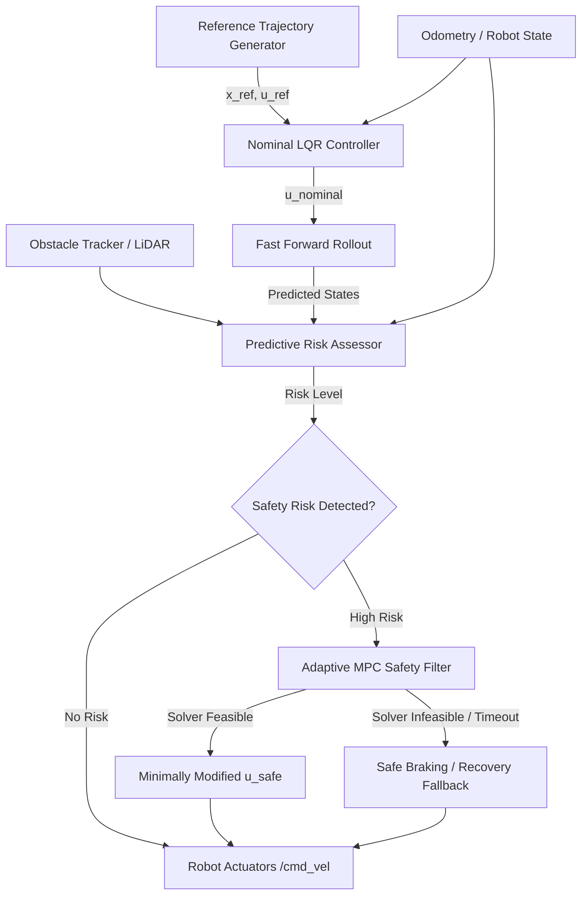

# Risk-Triggered Adaptive MPC Safety Filter with LQR Nominal Control


This repository implements **Risk-Triggered Adaptive MPC Safety Filtering with LQR Nominal Control** for differential-drive robot navigation.

The system uses an LQR controller as the primary nominal tracker for computational efficiency in open space. When a predicted forward rollout detects safety hazard or imminent obstacle proximity, an adaptive nonlinear MPC safety filter steps in to minimally modify the control command while satisfying state and actuator constraints.

**Authors**: Kshitiz Kumar Sinha, Agolika BM

---

## System Architecture

The control system architecture decouples nominal tracking, risk evaluation, and constrained safety filtering:



---

## Controller Variants

1. **LQR Controller**
   - High-rate nominal trajectory tracking.
   - Low computational overhead for real-time responsiveness.
   - Operates in open space without obstacle awareness.

2. **Tube MPC / Linearized MPC**
   - Finite-horizon constrained optimization using linearized obstacle boundaries.
   - Solved via CVXPY with OSQP backend.
   - Serves as a standard constrained control benchmark.

3. **Adaptive Nonlinear MPC**
   - Exact nonlinear kinematics optimized using CasADi and IPOPT.
   - Least Mean Squares (LMS) online parameter adaptation to estimate wheel slip and scale mismatch.
   - Extended terminal horizon with LQR rollout.

4. **Legacy Blended Hybrid LQR-MPC**
   - Baseline controller using continuous sigmoid command blending between LQR and MPC.
   - Retained in the repository for comparison and ablation studies.

5. **Risk-Triggered Adaptive MPC Safety Filter**
   - Main paper method.
   - LQR operates as the unconstrained default controller.
   - Forward prediction detects potential constraint violations in advance.
   - Adaptive MPC intervenes only when necessary to enforce safety bounds with minimal deviation from nominal commands.

---

## Repository Structure

```text
.
├── README.md                       # Project documentation and guide
├── requirements.txt                # Python dependencies
├── Dockerfile                      # Container environment for ROS2 Jazzy
├── docker-compose.yml              # Orchestration for simulation
├── run_simulation.py               # Standalone Python simulation runner
├── src/
│   └── hybrid_controller/          # Standalone control library (LQR, MPC, AMPC, Blender)
├── ros2_ws/
│   └── src/hybrid_nav/             # ROS2 Jazzy package with Gazebo launch files and nodes
├── evaluation/                     # Metric evaluation and plotting tools
├── results/                        # Trajectory, error, and control plots
├── logs/                           # Telemetry logs (CSV and JSON)
├── report/                         # Detailed LaTeX technical report and figures
└── docs/                           # Theoretical notes, proofs, and research proposals
```

---

## Installation and Setup

### 1. Python Environment

Install dependencies and install the `hybrid_controller` library in editable mode:

```bash
pip install -r requirements.txt
pip install -e src/hybrid_controller
```

### 2. Standalone Simulation

Run offline simulation across different controller modes without requiring ROS2:

```bash
# LQR nominal tracking
python run_simulation.py --mode lqr

# Tube MPC with obstacles
python run_simulation.py --mode mpc

# Adaptive MPC with parameter estimation
python run_simulation.py --mode adaptive

# Hybrid blended controller
python run_simulation.py --mode hybrid
```

Generated plots are automatically saved to `results/`.

### 3. ROS2 Gazebo Deployment

Build the ROS2 workspace:

```bash
cd ros2_ws
colcon build --symlink-install
source install/setup.bash
```

Launch the adaptive safety filter in Gazebo:

```bash
ros2 launch hybrid_nav turtlebot3_adaptive_safety_filter.launch.py
```

Launch arguments for testing dynamic obstacles or command mismatch:

```bash
ros2 launch hybrid_nav turtlebot3_adaptive_safety_filter.launch.py \
  use_actuation_mismatch:=true \
  obstacle_scenario:=crossing \
  obstacle_format:=quintuple
```

---

## Key Files

- Adaptive safety filter node: `ros2_ws/src/hybrid_nav/hybrid_nav/nodes/adaptive_safety_filter_node.py`
- Safety filter algorithm: `src/hybrid_controller/hybrid_controller/controllers/adaptive_mpc_safety_filter.py`
- Risk prediction: `src/hybrid_controller/hybrid_controller/controllers/risk_predictor.py`
- Backup safety policy: `src/hybrid_controller/hybrid_controller/controllers/backup_safety.py`
- Offline evaluation runner: `evaluation/plot_option_b_results.py`
- Detailed technical report: `report/report.tex`
