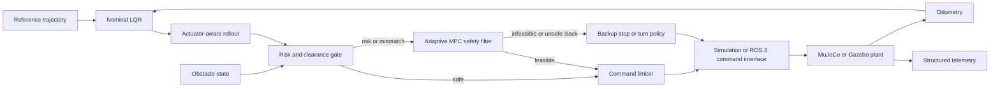
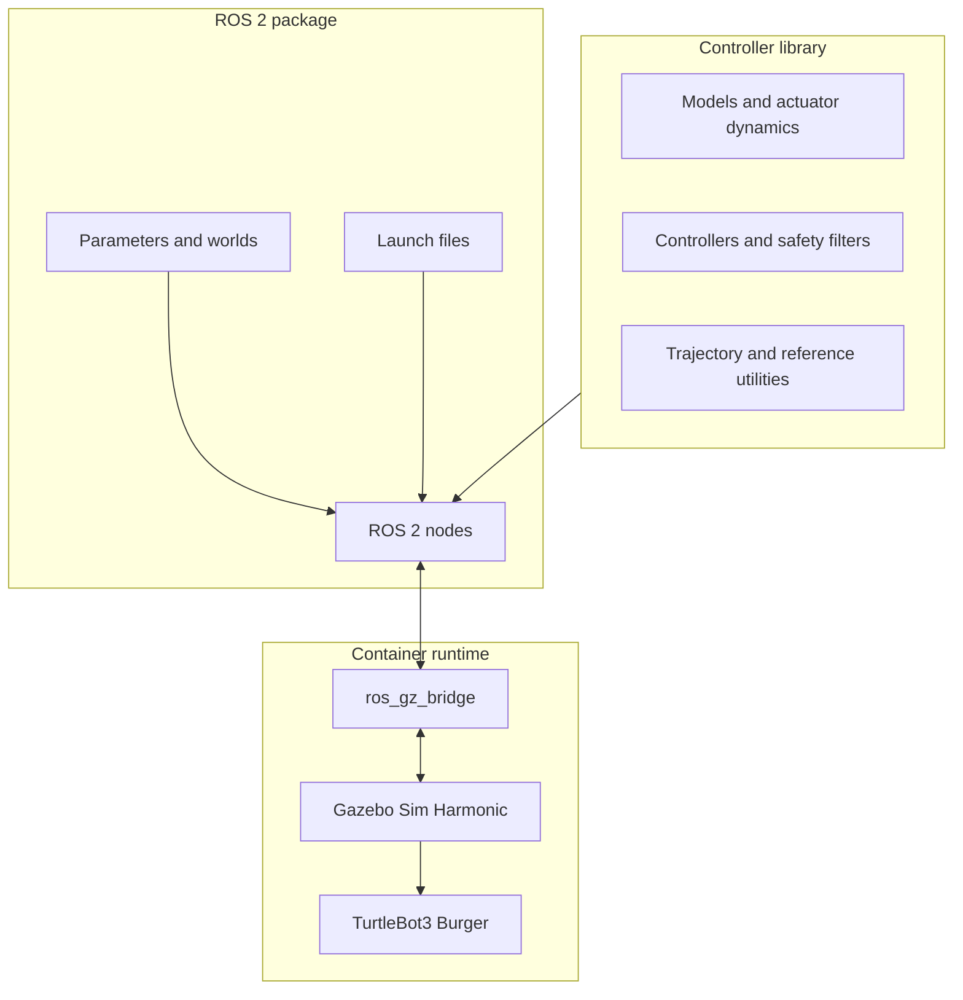

# Risk-Aware Hybrid LQR-MPC Navigation

Research software for differential-drive navigation with LQR nominal tracking,
MPC-based safety filtering, actuator-aware dynamics, and ROS 2 simulation.

The repository contains two connected execution paths:

1. A local Python and Rust path for fast controller tests and deterministic
   MuJoCo/RVO2 benchmarks.
2. A ROS 2 Jazzy path for TurtleBot3 and Gazebo Sim validation, built through
   Docker so the ROS installation is reproducible.

The current research direction is failure characterization for actuator-limited
navigation. The older smooth-blend hybrid controller remains available as a
baseline, but it is not presented as the safety method.

## Architecture



The ROS 2 integration follows the same boundary:



## Repository layout

```text
.
├── src/hybrid_controller/       Core Python controller package
├── crates/ra_psf_core/          Rust and PyO3 numerical core
├── ros2_ws/src/hybrid_nav/      ROS 2 nodes, launches, config, worlds, RViz
├── benchmarks/                  MuJoCo, RVO2, latency, and recoverability checks
├── tests/                       Python and Rust/Python parity tests
├── docs/                        Theory, proofs, references, and reports
├── report/                      LaTeX report source and report figures
├── Dockerfile                   ROS 2 Jazzy build image
├── docker-compose.yml           Local simulation and CI services
├── .github/workflows/ci.yml     Python, Rust, Docker, and ROS 2 checks
├── requirements.txt             Local Python dependencies
└── Makefile                     Common local commands
```

Generated files belong under `Output/`, `logs/`, or local build directories.
They are ignored by Git and are not part of the source layout.

## Local Python and Rust setup

Use Python 3.12 for the local controller and benchmark path:

```bash
python -m venv .venv
source .venv/bin/activate
export PATH="$HOME/.cargo/bin:$PATH"
python -m pip install --upgrade pip
python -m pip install -r requirements.txt
python -m pip install -e src/hybrid_controller
maturin develop --release --manifest-path crates/ra_psf_core/Cargo.toml
```

On Windows PowerShell, activate the environment with:

```powershell
.venv\Scripts\Activate.ps1
```

Run the local checks:

```bash
python -m pytest -q
python -m compileall -q benchmarks src tests ros2_ws/src/hybrid_nav
cargo test --manifest-path crates/ra_psf_core/Cargo.toml
```

The Rust extension must be built before running the parity tests. A system
Python interpreter that cannot import `ra_psf_rs` is not a valid test
environment for this repository.

## Deterministic recoverability validation

The first safety-analysis gate compares the continuous stopping proposition with
the exact zero-order-hold recurrence used by the actuator-aware model:

```bash
python -m benchmarks.validate_recoverability_gap \
  --output Output/Plots/Paper/recoverability_gap_validation
```

To include a small MuJoCo plant comparison:

```bash
python -m benchmarks.validate_recoverability_gap \
  --include-mujoco \
  --mujoco-samples 8 \
  --output Output/Plots/Paper/recoverability_gap_validation
```

The script writes JSON and CSV records. It reports discrete correction and
safe-boundary disagreement instead of hiding the difference in a fitted safety
constant.

## ROS 2 Jazzy with Docker

Docker is the supported ROS 2 setup. The image builds both active packages:

- `src/hybrid_controller`
- `ros2_ws/src/hybrid_nav`

Build the image:

```bash
docker compose build jazzy
```

Run the headless Gazebo Sim scenario:

```bash
docker compose up jazzy
```

The default service disables both RViz and the Gazebo graphical client, so it
does not require an X11 or WSLg display. On a host with a configured display,
pass `use_gz_gui:=true` and `use_rviz:=true` to the launch command to enable
visualization.

Run a custom launch file:

```bash
docker compose run --rm jazzy \
  ros2 launch hybrid_nav turtlebot3_adaptive_safety_filter.launch.py \
  use_rviz:=false \
  obstacle_scenario:=crossing \
  obstacle_format:=quintuple
```

For a local GUI session on Linux, use a display-enabled Docker setup and run the
launch command with `use_gz_gui:=true use_rviz:=true`. WSLg provides the display
bridge on supported WSL2 installations.

Run the same ROS 2 checks used by CI:

```bash
docker compose --profile ci run --rm ci
```

The CI service builds the workspace, runs `colcon test`, reports test results,
and checks that both ROS 2 packages are discoverable.

## ROS 2 package details

The active ROS 2 package is `hybrid_nav`. Its main entry points are:

| Area | Path or command |
| --- | --- |
| Current safety-filter node | `ros2 run hybrid_nav adaptive_safety_filter_node` |
| Current simulation launch | `ros2 launch hybrid_nav turtlebot3_adaptive_safety_filter.launch.py` |
| Legacy blended baseline | `ros2 launch hybrid_nav turtlebot3_hybrid.launch.py` |
| Parameters | `ros2_ws/src/hybrid_nav/config/params.yaml` |
| Gazebo world | `ros2_ws/src/hybrid_nav/worlds/hybrid_obstacle_world.sdf` |
| RViz configuration | `ros2_ws/src/hybrid_nav/rviz/hybrid_nav.rviz` |

The current launch path uses explicit topics, timestamps, and parameters. The
legacy blended launch remains for comparison and is labeled as a baseline.

## Benchmark commands

The native RVO2 binding is required for the dynamic-obstacle benchmark. The
runner raises if the binding is missing instead of silently changing the
experiment:

```bash
RVO2_PYTHON_PATH=/path/to/Python-RVO2 \
python benchmarks/run_mujoco_monte_carlo.py \
  --trials 20 \
  --duration 10.0 \
  --speed 1.5 \
  --dt 0.05 \
  --horizon 8 \
  --max-obstacles 5 \
  --modes 5_ra_psf_ours \
  --output Output/Plots/Paper/ablation_results
```

Benchmark trace files include pre-action state, previous and applied commands,
requested commands, obstacle snapshots, clearances, solver status, actuator
time constants, and fallback state.

## Documentation and research scope

- `docs/Adaptive_MPC_Theory.md`: current mathematical formulation.
- `docs/formal_proofs.md`: formal proof drafts and their assumptions.
- `docs/REFERENCES.md`: project bibliography.
- `benchmarks/README.md`: benchmark-specific commands and output schema.
- `report/report.tex`: historical implementation and evaluation report.

The current work is simulation-only. ROS 2 and Gazebo validation is containerized
but hardware deployment is out of scope. Results are diagnostic until the
footprint contract, actuator calibration, controlled state-gap grid, and
held-out parameter range are all validated.

The footprint contracts are explicit: the ROS controller uses its TurtleBot3
profile (`0.105 m`), while the custom MuJoCo box uses the circumscribed radius
of its declared `0.20 m x 0.14 m` half-extents (`0.2441 m`). The two values are
not interchangeable.

### Research gate status: October 23, 2026

**Gate 0 research acceptance is incomplete.** Environment checks and the
768-case primary / 162-case held-out analytical grids are complete. The
controlled physical sweep, actuator-model mismatch calibration, and secondary
clustered collision analysis remain open. The MuJoCo prefix is diagnostic
evidence of model mismatch, not validation of a correction or backup policy.

Provisional Docker Build Cloud CI and ROS 2 experiment tooling is described in
`docs/docker_build_cloud.md` and `docs/option_b_experiment_guide.md`. It captures
logs and generates PNG/PDF figures plus a human-validation report. Successful
container execution and human review remain pending. `MinMargin` measures the
nominal LQR rollout, so it must not be interpreted as measured collision
clearance. The current ROS harness does not record physical collision counts.
The CI Cloud builder is configured through the repository secrets
`DOCKER_USER` and `DOCKER_PAT`, using the `ros2-jazzy` builder.

## Working-tree hygiene

Do not commit:

- `.venv/`, `venv/`, or other local environments.
- `brain/`, `.agents/`, `.opencode/`, or generated skill metadata.
- `Output/`, `logs/`, `results/`, `build/`, `install/`, or `ros2_ws/log/`.
- Python caches, compiled extensions, or local IDE settings.

The Git history retains earlier experiments and legacy branches. The active
working tree should contain only the current controller, ROS 2 package,
benchmarks, tests, documentation, and reproducible build configuration.
