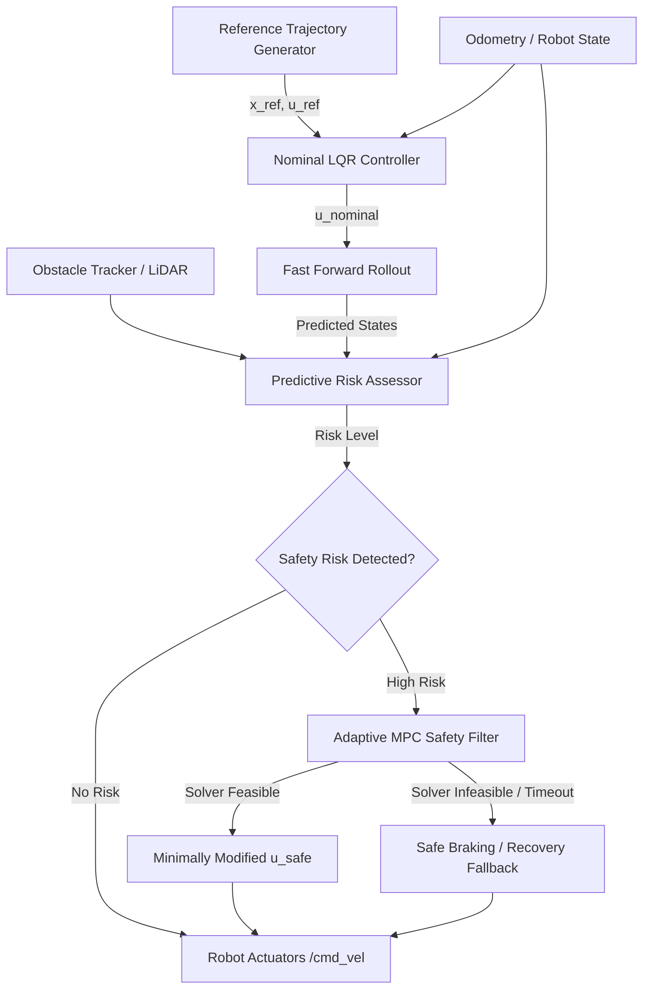

# Risk-Triggered Adaptive MPC Safety Filter with LQR Nominal Control


This repository implements **Risk-Triggered Adaptive MPC Safety Filtering with LQR Nominal Control** for differential-drive robot navigation.

The system uses an LQR controller as the primary nominal tracker for computational efficiency in open space. When a predicted forward rollout detects safety hazard or imminent obstacle proximity, an adaptive nonlinear MPC safety filter steps in to minimally modify the control command while satisfying state and actuator constraints.

**Authors**: Kshitiz Kumar Sinha, Agolika BM

## Validated RA-PSF upgrade

The current research implementation adds a 5D actuator-aware state
`[p_x, p_y, theta, v, omega]`, a separate spatial progress state `s`, and a
3D ESO disturbance estimate.  The Riccati-backed tangent-plane safety filter
uses analytical Gaussian CVaR padding, a DARE terminal cost, a step-zero
least-invasive penalty, soft obstacle constraints, per-tick control slew
limits, and a reusable CVXPY/OSQP workspace.

The native Rust extension in `crates/ra_psf_core` provides parity checks for
the dynamics, Jacobians, rollout, CVaR multiplier, and a stateful full-horizon
OSQP workspace with primal and dual warm-starting.  The Python filter remains
the reference formulation for numerical comparison.

The deterministic checks currently pass:

| Check | Result |
| --- | --- |
| State, ESO, and spatial projection tests | 3 passed |
| Rust and Python parity tests | 5 passed |
| RA-PSF, CVaR, fallback, and controller-seam tests | 10 passed |
| Existing MPC solution tests | 5 passed |
| Total test suite | 23 passed |
| Rust production latency gate | Mean 0.933 ms, p99 3.087 ms, 500 solves |
| Python reference timing | Mean 8.515 ms, p99 20.718 ms, 500 solves |

The benchmark setup and strict native RVO2 requirement are documented in
[`benchmarks/README.md`](benchmarks/README.md).

The current exploratory 20-trial run at 1.5 m/s measured zero RA-PSF
collisions, mean angular jerk RMS of 27.28, and mean latency of 4.87 ms.  The
same run measured 128.15 for convex blending and 83.23 for hard switching.
These are preliminary benchmark values.  A 200-trial shared-seed Gate 3
baseline has now been completed, but it exposed a reference-coordinate mismatch
and positive soft obstacle slack in the horizon-five benchmark configuration.
The baseline collision rates were 0.735 for nominal LQR, 1.000 for async NMPC,
0.555 for convex blending, 0.480 for hard switching, and 0.520 for RA-PSF.
Those results are diagnostic, not an accepted safety result.  The benchmark
now uses the LQR nominal rollout as the safety-filter state reference, and a
rerun of the corrected configuration remains required.  A corrected
horizon-eight 20-trial sample with five allocated obstacle slots measured a
0.10 collision rate, 7.86 ms mean latency, and 0.741 m RMS cross-track error.
The horizon, risk look-ahead, obstacle-slot bound, and experimental
slack-fallback policy are now explicit command-line options, but the measured
configurations are not accepted as production safety settings yet.

Diagnostic figures are written to
[`Output/Plots/Paper/`](Output/Plots/Paper/):

- `fig1_latency_cdf_violin.png` and `.pdf`
- `fig2_intervention_timeline.png` and `.pdf`
- `fig3_speed_latency_phase_diagram.png` and `.pdf`
- `fig4_slip_robustness_ablation.png` and `.pdf`

---

## System Architecture

The control system architecture decouples nominal tracking, risk evaluation, and constrained safety filtering:



---

## Controller Variants

1. **LQR Controller**
   - High-rate nominal trajectory tracking.
   - Low computational overhead for real-time responsiveness.
   - Operates in open space without obstacle awareness.

2. **Tube MPC / Linearized MPC**
   - Finite-horizon constrained optimization using linearized obstacle boundaries.
   - Solved via CVXPY with OSQP backend.
   - Serves as a standard constrained control benchmark.

3. **Adaptive Nonlinear MPC**
   - Exact nonlinear kinematics optimized using CasADi and IPOPT.
   - Least Mean Squares (LMS) online parameter adaptation to estimate wheel slip and scale mismatch.
   - Extended terminal horizon with LQR rollout.

4. **Legacy Blended Hybrid LQR-MPC**
   - Baseline controller using continuous sigmoid command blending between LQR and MPC.
   - Retained in the repository for comparison and ablation studies.

5. **Risk-Triggered Adaptive MPC Safety Filter**
   - Main paper method.
   - LQR operates as the unconstrained default controller.
   - Forward prediction detects potential constraint violations in advance.
   - Adaptive MPC intervenes only when necessary to enforce safety bounds with minimal deviation from nominal commands.

---

## Repository Structure

```text
.
├── README.md                       # Project documentation and guide
├── requirements.txt                # Python dependencies
├── Dockerfile                      # Container environment for ROS2 Jazzy
├── docker-compose.yml              # Orchestration for simulation
├── run_simulation.py               # Standalone Python simulation runner
├── src/
│   └── hybrid_controller/          # Standalone control library (LQR, MPC, AMPC, Blender)
├── crates/ra_psf_core/              # Rust and PyO3 numerical core
├── benchmarks/                      # MuJoCo, native RVO2, and latency gates
├── ros2_ws/
│   └── src/hybrid_nav/             # ROS2 Jazzy package with Gazebo launch files and nodes
├── evaluation/                     # Metric evaluation and plotting tools
├── results/                        # Trajectory, error, and control plots
├── logs/                           # Telemetry logs (CSV and JSON)
├── report/                         # Detailed LaTeX technical report and figures
└── docs/                           # Theoretical notes, proofs, and research proposals
```

---

## Installation and Setup

### 1. Python Environment

Install dependencies with `uv` in the Python 3.12 environment and build the
Rust extension:

```bash
uv pip install -r requirements.txt
maturin develop --release --manifest-path crates/ra_psf_core/Cargo.toml
```

The ROS 2 package remains a separate Jazzy environment.  It is not required
for the standalone tests or MuJoCo benchmark.

### 2. Standalone Simulation

Run offline simulation across different controller modes without requiring ROS2:

```bash
# LQR nominal tracking
python run_simulation.py --mode lqr

# Tube MPC with obstacles
python run_simulation.py --mode mpc

# Adaptive MPC with parameter estimation
python run_simulation.py --mode adaptive

# Hybrid blended controller
python run_simulation.py --mode hybrid
```

Generated plots are automatically saved to `results/`.

### 2.1 RA-PSF checks and MuJoCo smoke benchmark

```bash
python -m pytest -q tests
python benchmarks/benchmark_safety_filter.py
python benchmarks/run_mujoco_monte_carlo.py --trials 1 --duration 0.5
```

The MuJoCo and RVO2 commands require the environment variables described in
[`benchmarks/README.md`](benchmarks/README.md).  The runner raises when the
real RVO2 binding is unavailable.

### 3. ROS2 Gazebo Deployment

Build the ROS2 workspace:

```bash
cd ros2_ws
colcon build --symlink-install
source install/setup.bash
```

Launch the adaptive safety filter in Gazebo:

```bash
ros2 launch hybrid_nav turtlebot3_adaptive_safety_filter.launch.py
```

Launch arguments for testing dynamic obstacles or command mismatch:

```bash
ros2 launch hybrid_nav turtlebot3_adaptive_safety_filter.launch.py \
  use_actuation_mismatch:=true \
  obstacle_scenario:=crossing \
  obstacle_format:=quintuple
```

---

## Key Files

- Adaptive safety filter node: `ros2_ws/src/hybrid_nav/hybrid_nav/nodes/adaptive_safety_filter_node.py`
- Safety filter algorithm: `src/hybrid_controller/hybrid_controller/controllers/adaptive_mpc_safety_filter.py`
- Risk prediction: `src/hybrid_controller/hybrid_controller/controllers/risk_predictor.py`
- Backup safety policy: `src/hybrid_controller/hybrid_controller/controllers/backup_safety.py`
- Offline evaluation runner: `evaluation/plot_option_b_results.py`
- Detailed technical report: `report/report.tex`
